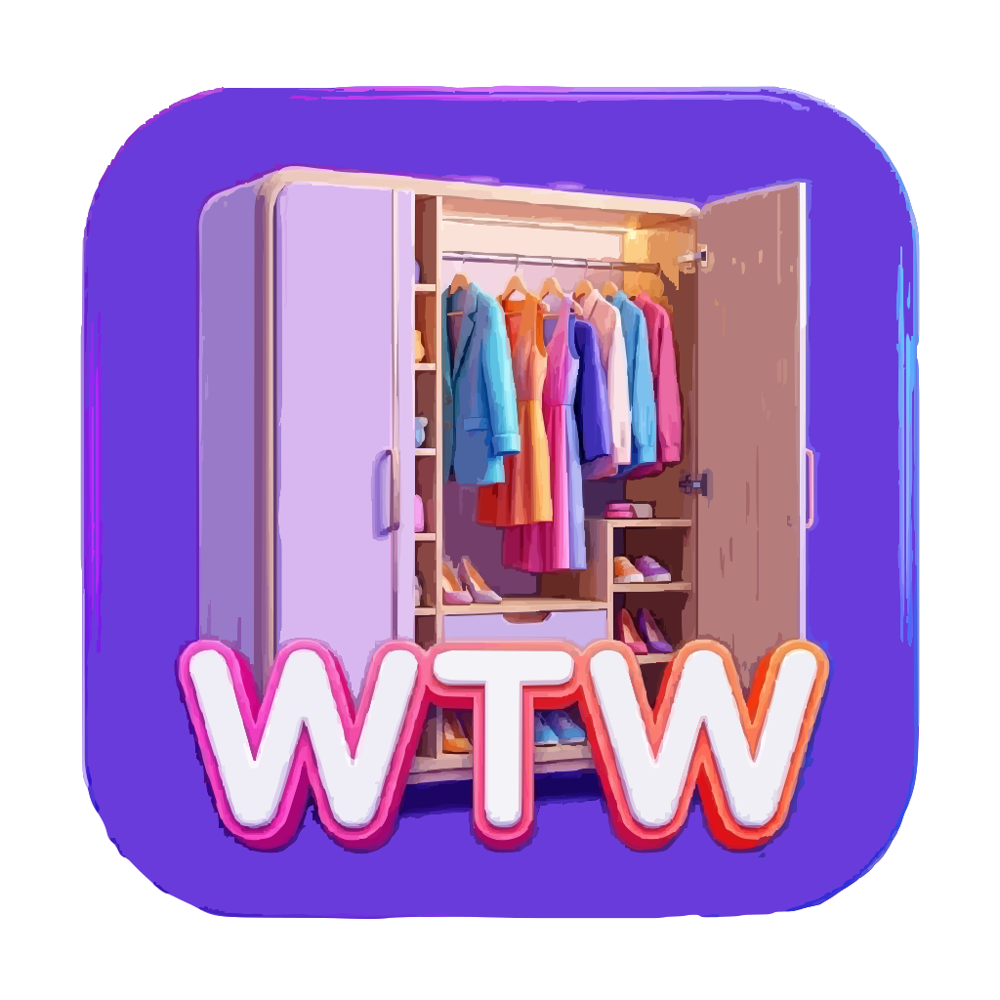

# 👔 What To Wear (WTW)

> Tu armario digital inteligente. Sube fotos de tu ropa, déjate clasificar por IA y recibe sugerencias de outfit cada día.



---

## ✨ Características

| Feature | Descripción |
|---------|-------------|
| 🤖 Clasificación IA | Gemini 1.5 Flash analiza tus fotos y las categoriza automáticamente |
| 🎠 4 Carruseles | Cabeza, Tronco, Piernas y Pies — toda tu ropa a golpe de dedo |
| ✨ Outfit aleatorio | Genera combinaciones coherentes (por nivel de formalidad) en un clic |
| 💬 Chat de moda | Describe cómo quieres vestir y la IA selecciona prendas de tu armario |
| ❤️ Favoritos | Guarda outfits en colecciones personalizadas con nombre y emoji |
| 📱 Mobile-first | Diseño responsive con bottom nav, dark mode y gestos táctiles |

---

### 2. Primera ejecución

1. Abre la app → te redirigirá a **Configuración**
2. Rellena:
   - **Supabase URL** → `https://xxxxxx.supabase.co`
   - **Supabase Anon Key** → `eyJhbG...`
   - **Gemini API Key** → `AIzaSy...`
3. Guarda y crea tu cuenta (o inicia sesión)
4. Ve a **Armario** → **+** → sube tu primera prenda 🎉

---


## 🧠 Flujos de IA

### Clasificación de ropa

```
Foto del usuario
  ↓ FileReader → base64
  ↓ Gemini Vision (gemini-1.5-flash)
  ↓ Devuelve JSON: { category, subcategory, colors, formality, name }
  ↓ Usuario revisa / edita
  ↓ Guardar en Supabase Storage + tabla clothes
```

### Generación de outfit por descripción

```
Texto del usuario: "Tengo una entrevista de trabajo, algo semiformal"
  ↓ Lista del armario del usuario (IDs + metadatos)
  ↓ Gemini Text (gemini-1.5-flash)
  ↓ Devuelve: { head, torso, legs, feet (IDs), explanation }
  ↓ Se seleccionan las prendas en los carruseles
  ↓ Se muestra la explicación debajo del chat
```

### Outfit aleatorio (sin IA)

```
Selecciona aleatoriamente un tronco → usa su nivel de formalidad como referencia
Para cada categoría: ordena prendas por cercanía de formalidad → elige al azar entre top-3
Resalta las prendas seleccionadas en los carruseles
```

---


## 🔒 Seguridad

- Las claves de API se guardan **únicamente en `localStorage`** del navegador, nunca en el servidor.
- Supabase tiene **Row Level Security (RLS)** activada: cada usuario solo accede a su propia ropa.
- Las imágenes se almacenan en un bucket **público** (para cargarlas sin autenticación), pero el path incluye el `user_id` para evitar colisiones.

---

## 📝 Licencia
No apto para uso público.
